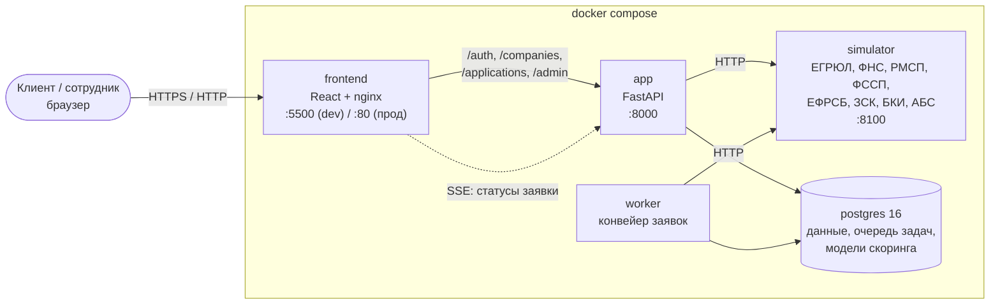
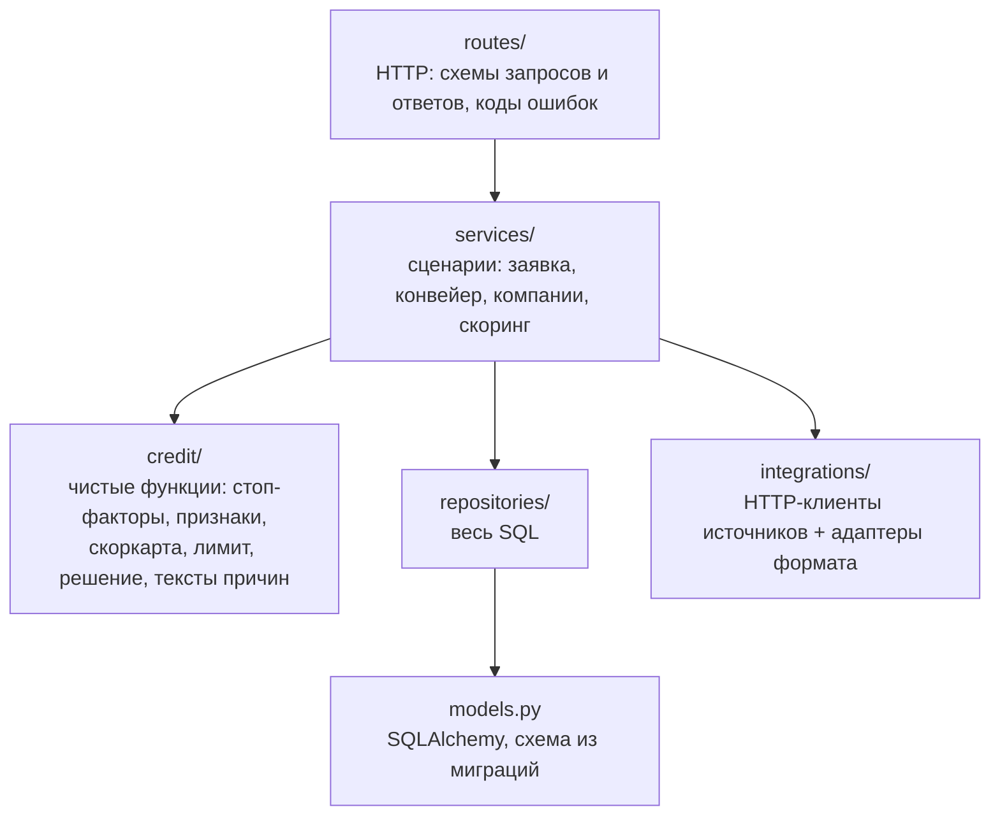
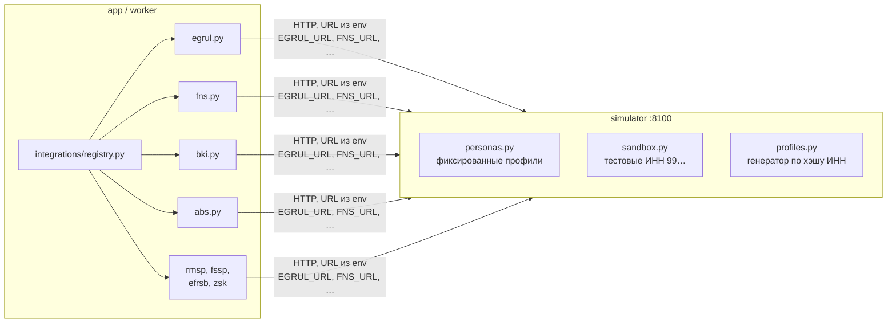

# Архитектура

Прототип состоит из пяти сервисов `docker compose`, одной базы PostgreSQL и симулятора внешних
источников. Всё работает автономно: реальные ФНС, БКИ и банк не вызываются, данные синтетические.

## Сервисы



| Сервис | Что делает | Проверка здоровья |
|---|---|---|
| `postgres` | Единственная база: клиенты, компании, данные источников, заявки, решения, модели, очередь задач | `pg_isready` |
| `app` | API (FastAPI). При старте применяет миграции, создаёт демо-учётки, загружает модели скоринга и (в dev) синтетику | `GET /health` — приложение живо и видит базу |
| `worker` | Берёт заявки из очереди и проводит их через конвейер до решения | свежесть heartbeat-файла |
| `simulator` | Отдаёт ответы «внешних» источников по ИНН — детерминированно, без базы | `GET /health` |
| `frontend` / `nginx` | Собранный React и прокси на `app` (для потока статусов — без буферизации) | загрузка главной страницы |

Порядок старта задан зависимостями: `postgres` и `simulator` → `app` (миграции) → `worker` и `frontend`.

## Путь заявки

```mermaid
sequenceDiagram
    autonumber
    actor C as Клиент
    participant F as Фронт
    participant A as app (API)
    participant DB as PostgreSQL
    participant W as worker
    participant S as simulator

    C->>F: Анкета, согласия
    F->>A: POST /applications (Idempotency-Key)
    A->>DB: заявка submitted + задача в очередь (одна транзакция)
    A-->>F: 201, номер заявки
    F->>A: GET /applications/{id}/events (SSE)
    W->>DB: взять задачу (FOR UPDATE SKIP LOCKED)
    W->>DB: статус scoring
    W->>S: ЕГРЮЛ, ФНС, ФССП, ЕФРСБ, ЗСК, БКИ, обороты
    S-->>W: ответы
    W->>DB: снимки ответов, разбор в таблицы
    W->>W: стоп-факторы → признаки → скоркарта → грейд → лимит DSCR → решение
    W->>DB: решение, баллы, причины; статус approved / declined / manual_review
    A-->>F: событие статуса (SSE)
    C->>F: Выбор варианта, код подписи
    F->>A: accept → sign-code → sign
    A->>DB: offer_accepted → contract_signed → issued
```

- **Очередь** — таблица `tasks` в той же базе; задача берётся с `FOR UPDATE SKIP LOCKED`, поэтому
  воркеров можно запустить несколько. Сбой источника или задачи → повтор с паузой, после
  `WORKER_MAX_ATTEMPTS` попыток — заявка на ручной разбор, а не ошибка клиенту.
- **Идемпотентность** — повтор отправки с тем же `Idempotency-Key` (в том числе одновременный двойной
  клик) возвращает ту же заявку. Номер заявки берётся из sequence.
- **Статусы в реальном времени** — Server-Sent Events: сервер отдаёт историю и новые смены статуса,
  поток закрывается на финальном статусе.
- **Подписание** — имитация SMS: код показывается в интерфейсе, в базе хранится только его хэш;
  код живёт 5 минут, после 5 неверных вводов сгорает.

## Решение по заявке

Правила — чистые функции в `src/app/credit/` (у каждой unit-тесты):

1. **Стоп-факторы** (`stop_factors.py`). Жёсткие (компания не действует, банкротство, красная зона ЗСК) —
   отказ без скоринга. Возраст бизнеса < 6 мес. — мягкий отказ с датой повторной подачи. Налоговый
   долг, долг ФССП, текущая или прошлая просрочка — ручной разбор.
2. **Признаки** (`features.py`) — из данных источников в базе; те же формулы, что при обучении
   (паритет проверяет `tests/api/test_scoring_parity.py`).
3. **Скоринг** (`scorecard.py`) — модель выбирается по сегменту (`scoring_segments`), балл → PD → грейд A–E.
   Подробно — [model-card.md](model-card.md).
4. **Лимит** (`limit.py`) — новый платёж помещается в доход с запасом: DSCR ≥ 1,25 с учётом текущих
   платежей по кредитам.
5. **Матрица** (`decision.py`): A–B — одобрение или контрпредложение (меньшая сумма на тот же срок и
   вся сумма на срок длиннее); C — ручной разбор; D–E — отказ. При отказе по доходу — альтернативы.
   Отказ и ручной разбор всегда с причинами простыми словами и советом (`reasons.py`).

Решение хранит версию модели, сегмент, входы, баллы по признакам, коды причин и варианты
(`credit_decisions.details`, `score_results`, `score_feature_values`).

## Слои кода



- `routes → services → repositories → models`; SQL только в `repositories`.
- `worker/` — цикл воркера, вызывает `services/pipeline.py`.
- Схема базы меняется только миграциями Alembic (`migrations/`); тест сверяет миграции с моделями.

## Внешние источники и симулятор



- Каждый источник — отдельный клиент в `src/app/integrations/` с адаптером формата; URL — из переменных
  окружения, таймаут и повторы — `SOURCE_*`. Подключить реальный источник = другой URL + адаптер.
- Ответ сохраняется снимком (`data_fetches`) и разбирается в таблицы (налоги, ФССП, кредиты БКИ, обороты…).
- Симулятор не пишет в базу приложения, приложение не читает данные симулятора в обход HTTP.
- Ответ по ИНН детерминирован: персоны и тестовые компании — фиксированные профили, любой другой
  корректный ИНН — сгенерированная компания.

## Кабинет администратора

`/adminuser` — внутренний разбор скоринга: все компании (синтетика и клиенты), разложение балла
по признакам, модели и калькулятор, выборки «решение × факт», champion / challenger, стабильность по месяцам.
Вход сотрудника отдельный (`staff_users`, токен сотрудника не принимается в клиентском API и наоборот).

## Деплой

Push в `main` → GitHub Actions копирует код на VPS и выполняет
`docker compose -f docker-compose.prod.yml up -d --build --wait`, затем проверяет `/health`.
В прод-конфигурации наружу открыт только nginx (порт 80), секреты — в `.env` на сервере.
