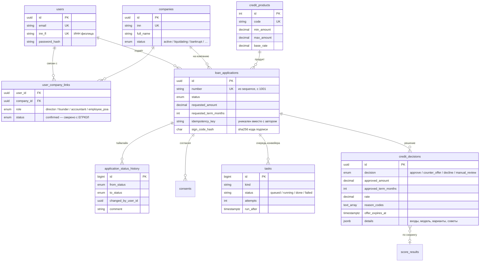
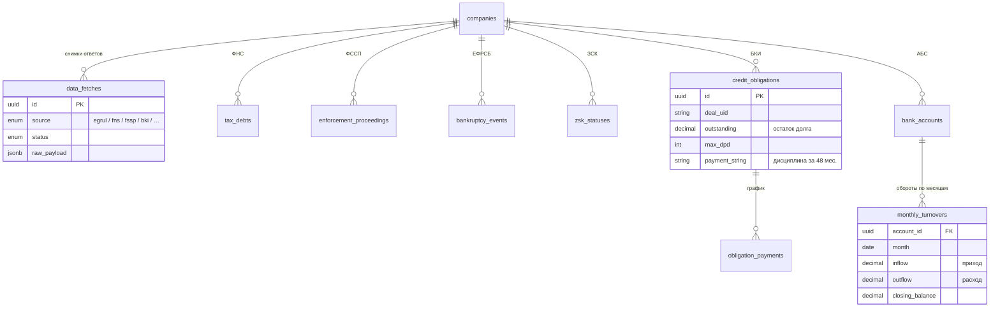
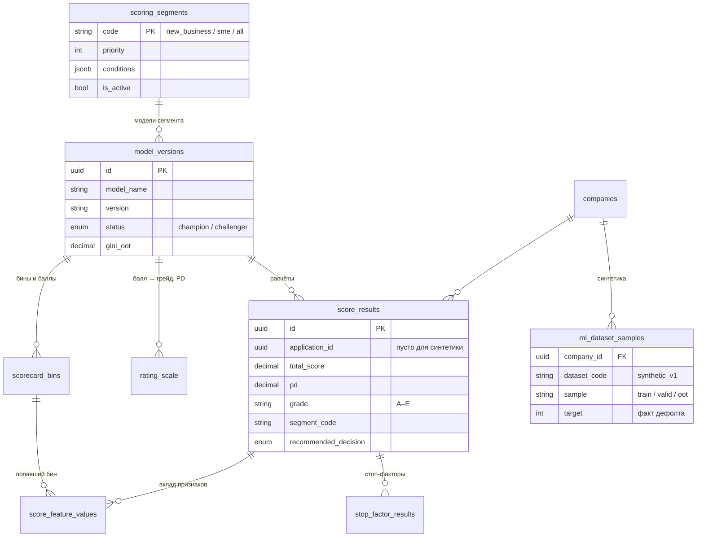

# Модель данных

Полная схема — [schema.dbml](schema.dbml) (67 таблиц, 25 перечислений; открывается на dbdiagram.io).
В базе она создаётся миграциями Alembic (`migrations/versions/`), модели SQLAlchemy — `src/app/models.py`;
тест `tests/unit/test_schema.py` проверяет, что миграции и модели совпадают.

Ниже — ключевые таблицы, через которые проходит сценарий «компания → заявка → решение».

## Клиент, компании, заявка, решение

## Данные внешних источников

Каждый ответ источника сохраняется снимком в `data_fetches` (сырой JSON), затем разбирается
в предметные таблицы с датой, на которую данные верны (point-in-time).

## Скоринг

- Модель выбирается по первому подошедшему активному сегменту (`scoring_segments.priority`); у сегмента
  рабочая модель — `champion`, иначе запасная `all`.
- `score_feature_values` хранит значение признака, бин и баллы — из них строится разбор «почему такой балл».
- Синтетика (`ml_dataset_samples`) лежит в тех же таблицах, что и данные клиентов, поэтому кабинет
  администратора показывает их одинаково.

## Отступления от schema.dbml

- `users.password_hash`, `staff_users.login` / `password_hash` — вход клиента и сотрудника;
  `users.email` и `users.inn_fl` уникальны.
- Идентификаторы генерирует приложение (`uuid4`), перечисления — нативные типы PostgreSQL с теми же именами.
