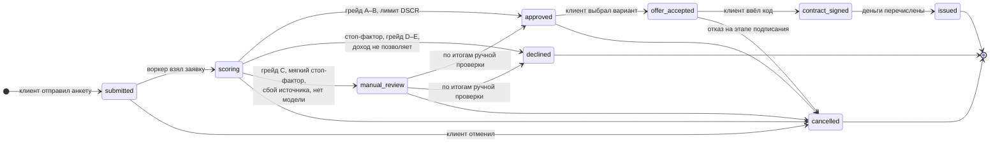

# Статусы заявки

Статус меняет только сервер: клиент вызывает действие, сервер проверяет, разрешён ли переход
из текущего статуса. Недопустимый переход — ответ **409 Conflict**, статус не меняется.
Каждый переход пишется в историю (`application_status_history`: из какого, в какой, кто, комментарий) —
из неё строится таймлайн в кабинете и поток статусов (SSE).

Правила переходов — `src/app/credit/statuses.py`, тесты — `tests/unit/test_decision.py`
и `tests/api/test_decisions.py`.

## Автомат

Финальные статусы: `issued`, `declined`, `cancelled` — после них переходов нет, поток статусов закрывается.

## Кто переводит

| Переход | Кто | Где в коде |
|---|---|---|
| → `submitted` | клиент: `POST /applications` | `services/application.py::submit` |
| `submitted` → `scoring` → `approved` / `declined` / `manual_review` | воркер конвейера | `services/pipeline.py::process_application` |
| сбой источника или задачи после всех повторов → `manual_review` | воркер | `services/pipeline.py::send_to_manual_review` |
| `manual_review` → `approved` / `declined` | банк по итогам ручной проверки | автомат статусов разрешает переход |
| `approved` → `offer_accepted` | клиент: `POST /applications/{id}/accept {offerIndex}` | `accept` |
| `offer_accepted` → `contract_signed` → `issued` | клиент: `sign-code`, затем `sign {code}`; выдача сразу после подписи | `sign_code`, `sign` |
| любой нефинальный (кроме `contract_signed`) → `cancelled` | клиент: `POST /applications/{id}/cancel` | `cancel` |

Если клиент отменил заявку, пока воркер её считал, воркер перед записью решения ещё раз блокирует
заявку и видит отмену — решение не записывается.

## Ответы на недопустимые действия

| Ситуация | Ответ |
|---|---|
| Переход не разрешён автоматом (принять отказ, подписать без принятия, отменить выданный) | 409 |
| Срок предложения истёк (`credit_decisions.offer_expires_at`) | 409 |
| Неверный, устаревший (старше 5 минут) или сгоревший после 5 ошибок код подписи | 422 с текстом у поля `code` |
| Чужая заявка | 404 — существование чужой заявки не раскрывается |

## Как статус видит клиент

В базе статусов больше, чем нужно клиенту, поэтому API отдаёт упрощённый статус и подпись
(`services/application.py`, `_CLIENT_STATUS`).

| Статус в базе | Клиент видит | Подпись в таймлайне |
|---|---|---|
| `draft` | `draft` | Черновик |
| `submitted` | `submitted` | Заявка отправлена |
| `data_collection`, `scoring` | `checking` | Собираем данные / Оцениваем заявку |
| `manual_review` | `checking` | На рассмотрении у специалиста |
| `approved` | `approved` или `counter_offer`, если сумма или срок отличаются от запроса | Одобрено / Предложены другие условия |
| `offer_accepted`, `contract_signed` | `signing` | Подписание / Договор подписан |
| `issued` | `issued` | Кредит выдан |
| `declined` | `rejected` | Отказ |
| `cancelled` | `cancelled` | Заявка отменена |

Контрпредложение — отдельного статуса нет: это `approved` с решением `counter_offer` и двумя вариантами
(меньшая сумма на запрошенный срок или вся сумма на срок длиннее).
